# Alba: Secret History

A small first-person horror game set on a Samhain night in the Scottish Highlands, built with
Unity 6. Find the sealstones that open the old stone circles, light the lanterns, fight the
creatures that come out of the dark, and escape before dawn.

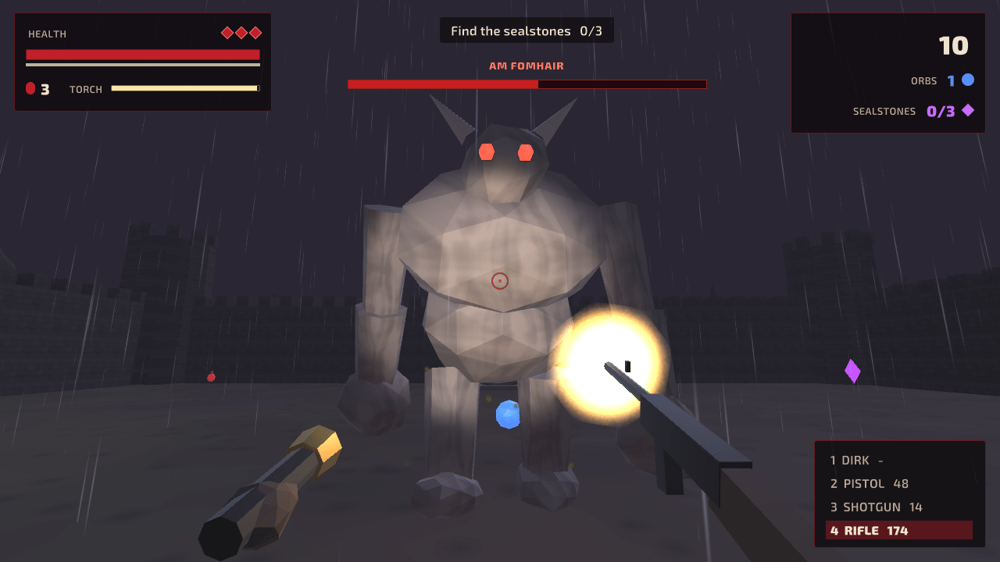

| | |
|---|---|
| 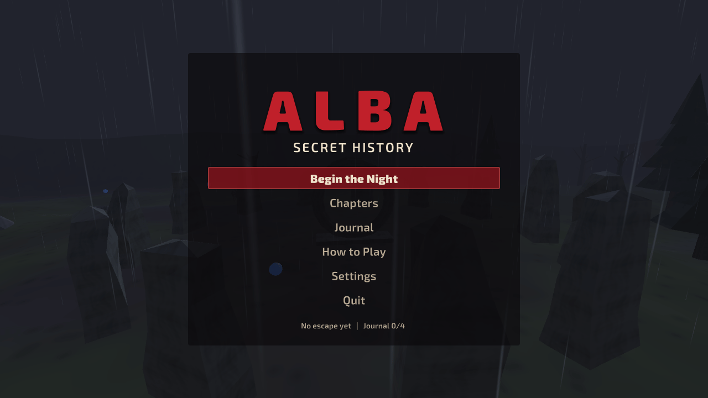 | 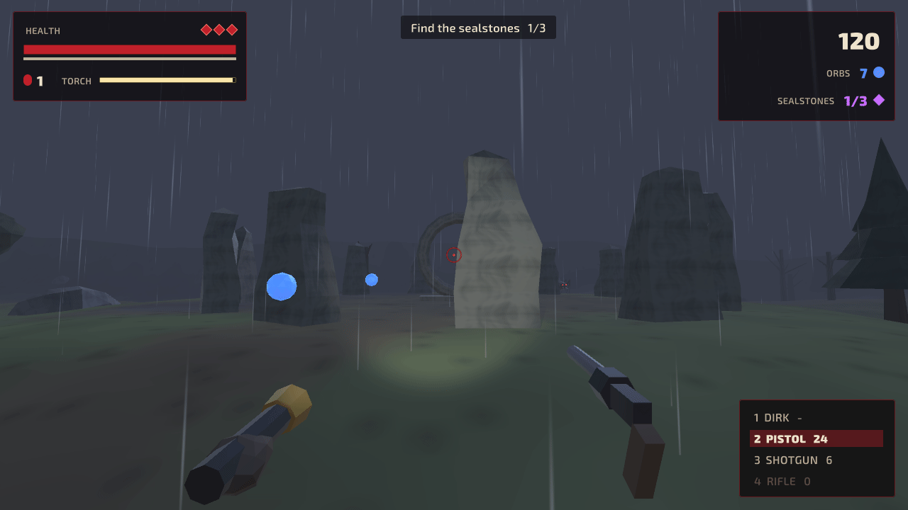 |
| 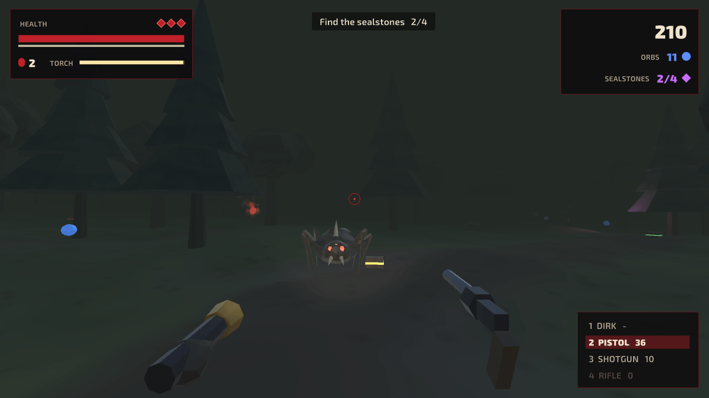 | 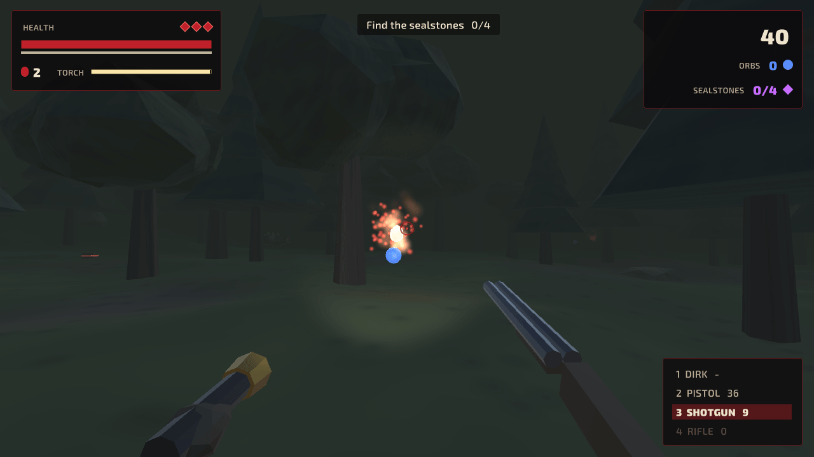 |
| 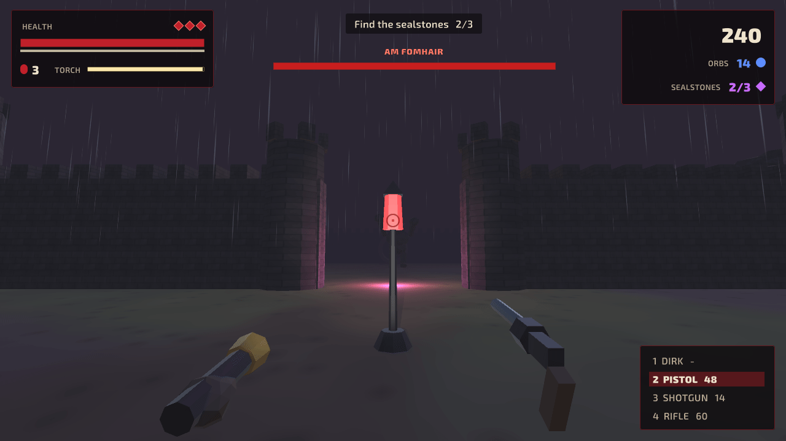 | 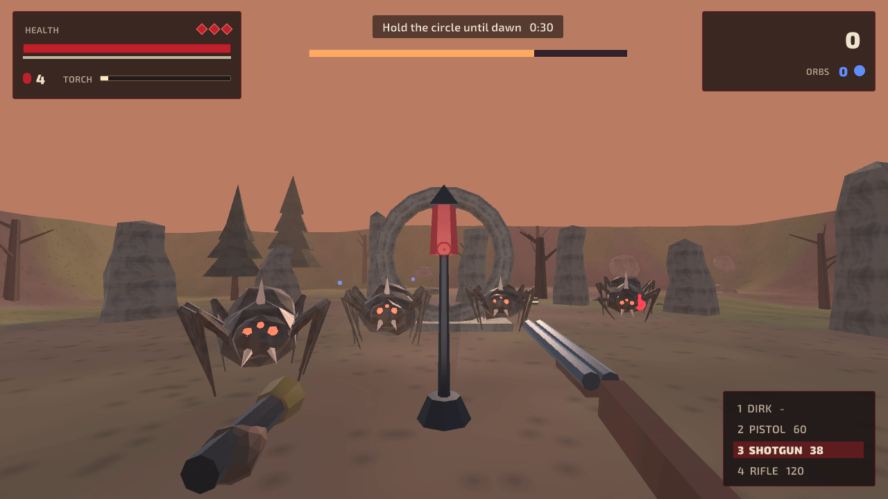 |
| 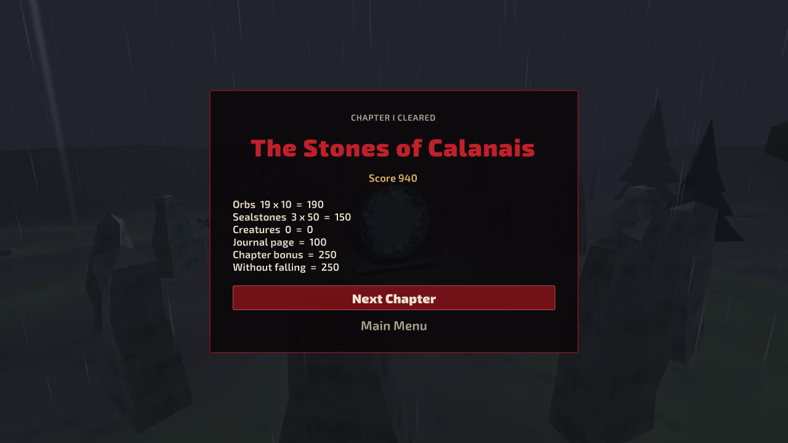 | 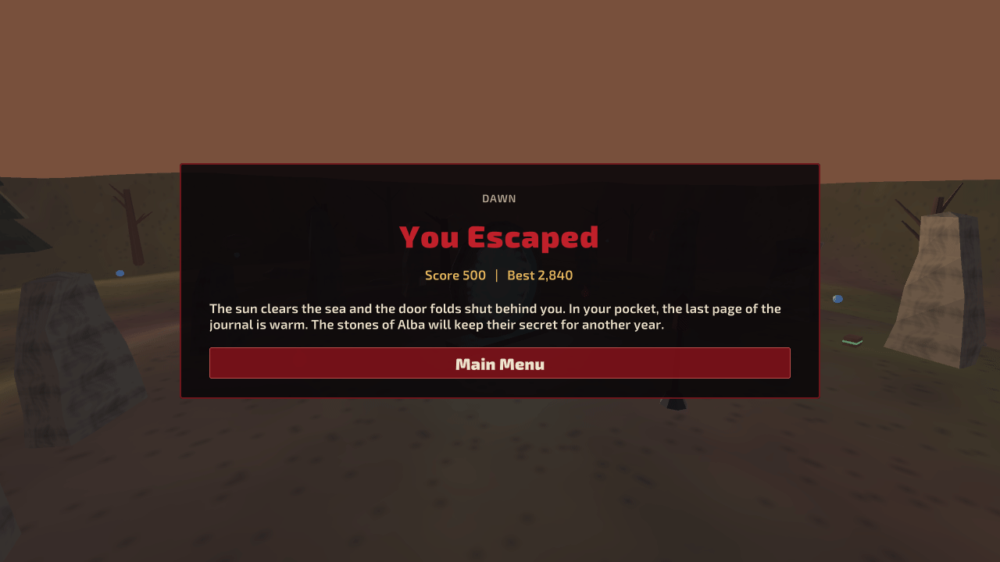 |

## Run it

1. Install **Unity 6000.3.27f1 (Unity 6 LTS)** with Unity Hub (add the Windows or Web build
   support module if you want to build players).
2. In Unity Hub choose **Add → Add project from disk** and select the repository folder.
3. Open `Assets/Scenes/Alba.unity` and press **Play**. Click the Game view to capture the mouse.

To build a player use **File → Build Profiles** (Windows or Web), or build from a terminal into
a folder outside the repository:

```bash
Unity -batchmode -quit -projectPath . -executeMethod Alba.EditorTools.ProjectBuilder.BuildWebGL -buildOutput ../build/web
```

(`BuildWindows` works the same way.) The WebGL build is uncompressed, so it runs from any
static host such as GitHub Pages; click the page to capture the mouse.

The tests run from **Window → General → Test Runner** (EditMode and PlayMode), or from a terminal:

```bash
Unity -batchmode -projectPath . -runTests -testPlatform EditMode -testResults editmode.xml
Unity -batchmode -projectPath . -runTests -testPlatform PlayMode -testResults playmode.xml
```

The README screenshots come from an opt-in hook: run a built player with
`-screenshot <folder>` (optionally `-scenario title,intro,stones,wood,wisp,keep,giant,dawn,pause,clear,gameover,victory,journal,howto`),
or, without a player,
`Unity -batchmode -projectPath . -executeMethod Alba.EditorTools.ProjectBuilder.CaptureScreenshots -screenshot <folder>`.

All art and audio are generated. To change the sounds, edit and rerun the synthesizer (Python 3
standard library and `ffmpeg` on the PATH); to regenerate the materials, font atlases, icon,
scene and settings, run the project builder:

```bash
python tools/audio/build.py
Unity -batchmode -quit -projectPath . -executeMethod Alba.EditorTools.ProjectBuilder.SetUpProject
```

## Controls

The keyboard layout is the one of the 2021 game, with sprinting and a gamepad added.

| Action | Keyboard and mouse | Gamepad |
|---|---|---|
| Move | W A S D or the arrow keys | Left stick |
| Sprint | Shift | Click the left stick or hold LT |
| Look | Mouse | Right stick |
| Shoot or swing | Left click (hold for the rifle) | RT |
| Dirk, pistol, shotgun, rifle | 1, 2, 3, 4 or the mouse wheel | D-pad left, up, right, down, or LB / RB |
| Torch on and off | F | Y |
| Drink a potion | Q | X |
| Pause | P or Esc | Start |
| Menus | Arrows or W / S, Enter, Esc (or the mouse) | D-pad or stick, A, B |

Settings: music and sound volume, look speed, inverted look and brightness, saved between sessions.

## How it plays

- **The story.** Folklorist Eilidh Ross follows her grandfather's journal to the Isle of Lewis.
  He believed the standing stones of Alba are locks on a door that opens on Samhain night. The
  door is open, and the only way home is through it, before dawn closes it again.
- **Four chapters.** The Stones of Calanais (a rainy moor and its stone circle), the Black Wood
  (a fog-filled pinewood full of wisps), Dunadd Keep (a ruined hill fort guarded by Am Famhair,
  the giant of the old stories) and Alba, a last circle on the cliffs where you hold out
  against waves of creatures until sunrise. Each opens with a story card.
- **The goal.** Purple sealstones (3, 4 and 3) open the portal at the heart of each chapter's
  circle; at Dunadd the giant must fall too. Red lanterns are checkpoints: light one and you
  wake there after a fall. Three lives per chapter; losing them all ends the night, and the
  chapter can be tried again from its start.
- **Tools.** A dirk that never runs out, a pistol, a two-barrelled shotgun and a rifle, with
  ammunition boxes to find; potions in a flask; stamina for sprinting; and a torch whose battery
  drains while it is on and recovers while it is off.
- **Creatures.** Crawlers chase what they see and rear up before they strike, so backing away
  makes them miss. Wisps drift through trees and can only be hurt, and are slowed, inside the
  torch beam. Am Famhair raises both fists before it slams the ground; at half health it rages,
  moves faster and calls three crawlers.
- **Score and records.** Orbs 10, sealstones 50, journal pages 100, creatures 25 to 600, 250
  for every chapter and 250 more for one cleared without falling. The best score, the chapters
  unlocked, the journal pages found and the escapes are saved on the device (PlayerPrefs).
  Pages can be read from the Journal in the main menu.

## What I learned / technically interesting

- **Rules without the engine.** Everything that decides the game lives in
  `Assets/Scripts/Core`, a plain C# assembly with no Unity references: movement with stamina on
  the ground plane, collision against circles and boxes, ray casts for bullets and line of sight,
  the torch cone, weapons and ammunition, the creatures' state machines, pickups, lanterns, the
  portal, the dawn waves, lives, score, records and settings. Chapters are data: hand-placed
  sealstones, lanterns, foes and supplies, plus trees, rocks and orbs scattered with a seed. 63
  EditMode tests cover it, including a flood fill that proves every sealstone, lantern, page and
  portal of the four chapters can be reached on foot.
- **A world made of code.** There are no models or textures in the repository. Rocks, standing
  stones, trees, walls and creatures are faceted meshes generated in `MeshFactory`, painted with
  noise textures from `TextureFactory` (the ground of a chapter is one painted texture with its
  trail and worn stone circles), and merged into one mesh per material, so a chapter of hundreds
  of trees draws in a handful of calls. Crawlers walk on eight animated legs, wisps are particle
  flames, and the giant is animated from its state (walk, windup, slam, fall).
- **Feedback from events.** The core reports what happened in each step (a shot, a hit, a
  windup, a lantern lit, the portal opening) and the game layer turns those events into sounds,
  particles, camera shake, banners and hints, so the rules never call into Unity.
- **Tested flows.** Eleven PlayMode tests drive the real scene: the prologue and first steps,
  lanterns and respawns, game over and retry, sealstones opening the portal and unlocking the
  next chapter, pause (including Esc and P on a virtual keyboard), restart, settings, the journal,
  the dawn ending, and leaving through the pause menu right after an escape.
- **Generated audio and assets.** Music in Scottish modes over a pipe-like drone, rain and wind,
  and every effect come from a small synthesizer in `tools/audio`; the materials, font atlases,
  icon, scene, quality and player settings come from `ProjectBuilder.cs`. The UI is UI Toolkit
  built in code, and input goes through the Input System.

## History

*Alba* began in 2021 as a university homework at the Technological University of Peru (UTP): a
first-person horror proof of concept made with Asset Store art. It had a title over the
Calanais stones, a flashlight, four weapon slots, potions, blue orbs and purple gems, spider-like
creatures and an ogre in a castle courtyard, a blue portal to escape through, and "You Escaped"
and "You Didn't Escape" endings with a best score. A video of that version is on
[YouTube](https://youtu.be/bA61OmH7u24).

| | | |
|---|---|---|
| 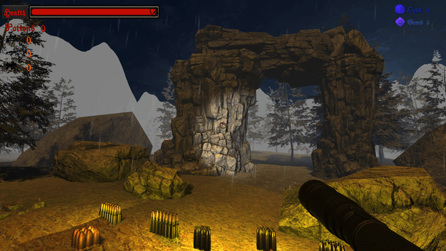 | 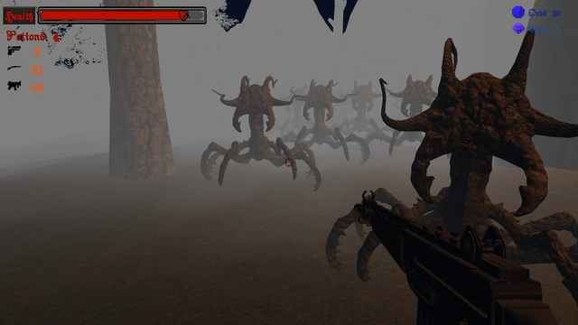 | 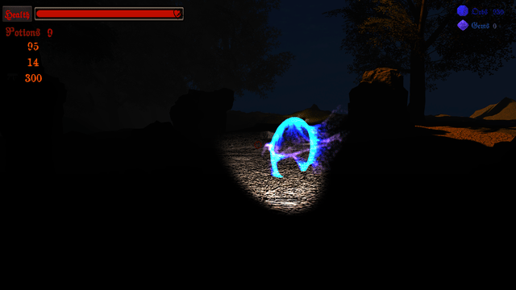 |

These three captures show third-party Asset Store art and are kept only as a record of the 2021 version; they are not covered by this repository's MIT licence.

The project itself was never pushed here (it was 1.7 GB and used store assets and music that
cannot be shared), so in 2026 the game was rebuilt from scratch in Unity 6 from those captures:
same title, setting and core loop, with a story, four chapters, new creatures, checkpoints,
menus and settings, gamepad support and generated art and audio.

## Credits

Everything in the game was made for this project, except the Exo 2 font (SIL Open Font
License). See [CREDITS.md](CREDITS.md).

## License

[MIT](LICENSE).
